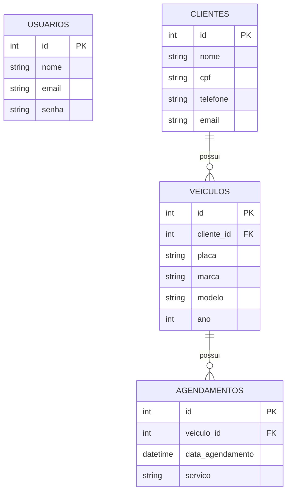

# DER - Sistema da Oficina Mecanica

## Observacoes

- `clientes.cpf` e armazenado criptografado (AES-256-CBC) [RN03].
- `usuarios.senha` e armazenada como hash (bcrypt), nao pode ser revertida.
- `usuarios` nao se relaciona com as demais tabelas: serve apenas para login.
